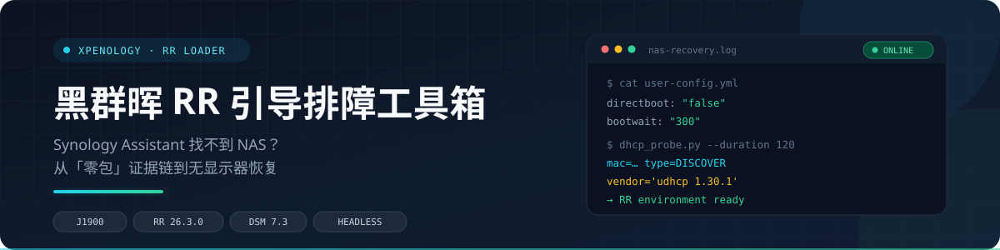
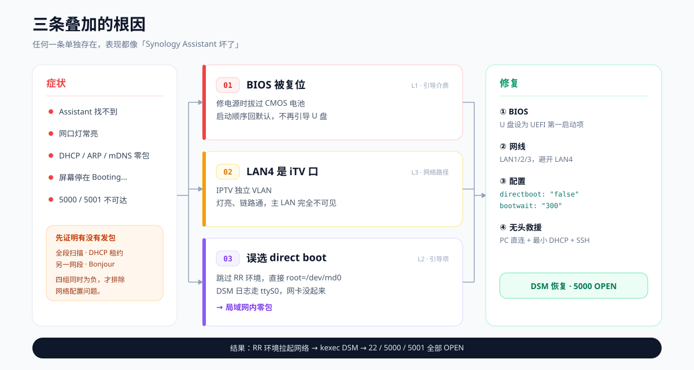
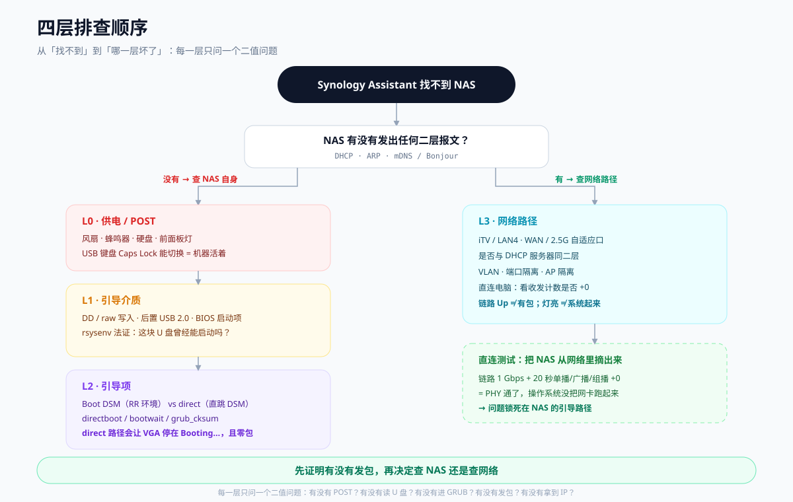

<div align="center">
  <a href="docs/assets/banner.svg"></a>
</div>

<p align="center">
  
  
  
  
  
</p>

<p align="center">
  <b>Synology Assistant 找不到 NAS？</b><br>
  先用「零包」证据链判断问题在哪一层，再用无显示器流程把它救回来。
</p>

> **30 秒版**：不是 Assistant 的问题，也不是网线。NAS 因为 **BIOS 复位 + LAN4 iTV VLAN + 误选 direct boot** 三条叠加，从头到尾一个包都没发。修法：BIOS 设 U 盘启动 → 换 LAN1/2/3 → `directboot=false` + `bootwait=300` → PC 直连 + 最小 DHCP + RR SSH。

---

## 问题现场

一台**星际蜗牛 J1900D** 黑群晖，DSM 装在 500G 机械盘上，16G mSATA 已拔除，靠一块 RR 引导 U 盘启动。

症状看起来非常像「网络问题」：

- Synology Assistant 在局域网里**找不到**它
- 网口灯**常亮**，链路看起来正常
- 但 DHCP 租约、ARP 表、mDNS/Bonjour 里**全都没有它**
- 接到显示器时，屏幕停在 `Booting...` 不动

换网线、换 LAN 口、重刷 U 盘、检查防火墙——都没用。因为真正的问题不在网络，而在**引导路径**。

---

## 根因：三条叠加

<a href="docs/assets/root-cause.svg"></a>

<p align="center"><sub>点击图片查看大图</sub></p>

| # | 根因 | 表现 |
|---|---|---|
| 01 | **BIOS 被复位**：修电源时拔过 CMOS 电池，启动顺序回到默认，不再从 U 盘引导 | 连 GRUB 都没进，自然零包 |
| 02 | **LAN4 是 iTV 口**：IPTV 独立 VLAN，和主 LAN 不在同一个二层域 | 灯亮、链路通，但主 LAN 完全看不到 |
| 03 | **误选 `Boot DSM kernel directly`**：跳过 RR 环境，直接 `root=/dev/md0` 引导 DSM | DSM 日志走 `ttyS0`，VGA 停在 `Booting...`；网卡没起来 → 零包 |

任何一条单独存在，都足以让 Assistant 找不到。三条同时存在，就出现了「怎么换都没反应」的假象。

---

## 解决：四步

### ① BIOS：让机器重新从 U 盘启动

- 进 BIOS（`Del` / `F2`），把 `UEFI: <你的 U 盘>` 设为 `Boot Option #1`
- 老平台优先确认 UEFI / Legacy 与上次成功时一致；SATA = AHCI
- 顺手换一颗 **CR2032**——这块 2018 年的电池已经没电，断电就会丢设置

### ② 网线：避开 iTV 口

- 从 **LAN4** 换到 **LAN1 / LAN2 / LAN3**
- 同时避开 WAN 口和 2.5G 自适应口

### ③ 配置：`directboot` 和 `bootwait` 一起改

这是整晚最关键的发现。网上多数教程只说「把 `directboot` 改成 `false`」，但读 RR 的 `boot.sh` 会发现：

- `directboot=false` 只是**不立即**引导 DSM；
- 它仍会进入 `_bootwait` 倒计时，默认只有 **10 秒**；
- 10 秒后照样 `kexec` 进 DSM；
- 唯一的中断方式是：倒计时内有新的 SSH / Web 会话，或打开菜单。

所以最小正确改法是两项一起：

```diff
- directboot: "true"
+ directboot: "false"

- bootwait: "10"
+ bootwait: "300"
```

`grub.cfg` 不需要动——`grub_cksum.syno` 校验的是 `/zImage` 和 `/rd.gz`，不是它。

### ④ 无显示器救援：PC 直连 + 最小 DHCP + RR SSH

```
PC 先切 Wi-Fi 保住网络
  → 有线网口直连 NAS
  → 起一个最小 DHCP 服务
  → 看 DHCP 日志指纹：
       vendor='udhcp 1.30.1'  → RR 环境（TinyCore）起来了
       host='<主机名>'         → DSM 起来了
  → RR 环境 SSH root/rr，或浏览器打开 :7681
  → 建立会话本身就会打断 _bootwait 倒计时
```

这条路径完全不依赖屏幕和键盘，是这次能救回来的核心方法。

> **结果**：NAS 重新上线，`22 / 5000 / 5001` 全部 OPEN，DSM 登录页 HTTP 200。真正修好的不是网络，而是引导路径。

---

## 为什么这份文档值得看

| # | 内容 | 为什么少见 |
|---|---|---|
| 1 | **RR 引导 `directboot` / `bootwait` 的真实语义** | 网上多数教程只说「把 directboot 改成 false」。实际只改这一项，10 秒后它**仍然会 kexec 进 DSM**。必须同时拉长 `bootwait`，并在窗口内建立 SSH / Web 会话。 |
| 2 | **无显示器恢复流程** | 不接屏幕、不进 GRUB 菜单，靠 PC 直连 + 最小 DHCP + RR 环境 SSH（`root/rr`）完成诊断和恢复。全程有可观察的数字证据。 |
| 3 | **「零包」证据链** | 把「Assistant 找不到」拆成供电 / 引导介质 / 引导项 / 网络路径四层，每一层给出可观测现象和排除方法。避免在错误的方向上换网线、重刷 U 盘。 |

---

## 四层决策树

<a href="docs/assets/decision-tree.svg"></a>

<p align="center"><sub>点击图片查看大图</sub></p>

---

## 仓库结构

```
黑群晖Synology/
├── README.md                      # 你正在看的这一页
├── docs/
│   ├── 01-RR引导排障手册.md        # 四层决策树、启动流程、directboot/bootwait、无头恢复
│   ├── 02-无显示器恢复实录.md      # 完整时间线、证据链、假阳性复盘
│   ├── 03-DSM运维笔记.md           # SSH / SFTP / sudo / 时间 / 端口 / 安全自查
│   └── assets/                    # banner / 根因图 / 决策树
└── tools/
    ├── dhcp_probe.py              # 被动监听 DHCP，识别是谁在要地址
    ├── dhcp_server.py             # 最小 DHCP 服务，直连救援用
    ├── wait_rr_ssh.py             # 等 RR 环境 22 端口并抓诊断信息
    ├── nic_counter.ps1            # Windows 网卡计数采样，无屏幕时的“示波器”
    └── patch_rr_config.py         # 安全修改 user-config.yml（备份 + diff 校验）
```

## 工具

| 脚本 | 用途 | 依赖 |
|---|---|---|
| [`dhcp_probe.py`](tools/dhcp_probe.py) | 被动监听 DHCP，区分 RR 环境 / DSM / 电脑自己 | Python 3，管理员/root |
| [`dhcp_server.py`](tools/dhcp_server.py) | 给直连的 NAS 发地址，把它拉进可访问状态 | Python 3，管理员/root |
| [`wait_rr_ssh.py`](tools/wait_rr_ssh.py) | 等 RR 环境 22 端口，自动 SSH 登录并抓磁盘/网络/会话 | Python 3 + paramiko |
| [`nic_counter.ps1`](tools/nic_counter.ps1) | Windows 网卡收发计数采样，判断对端有没有发包 | PowerShell |
| [`patch_rr_config.py`](tools/patch_rr_config.py) | 安全修改 `user-config.yml`（自动备份 + 逐行 diff） | Python 3 |

---

## 快速开始：无显示器救回一台 RR 黑群晖

前提：电脑有**有线网口 + Wi-Fi**（Wi-Fi 用来保住远程/网络，网口腾给 NAS），NAS 与电脑网线直连。

```bash
# 1. 把 U 盘插到电脑，确认 RR 分区（Windows 可能不显示盘符）
python tools/patch_rr_config.py --config "\\?\Volume{...}\user-config.yml" \
    --directboot false --bootwait 300 --apply

# 2. 在电脑有线网口上起 DHCP（地址要避开 ZeroTier / 虚拟网卡）
python tools/dhcp_server.py --server-ip 169.254.10.1 --offer-ip 169.254.10.3

# 3. U 盘插回 NAS，冷启动；观察 DHCP 日志
#    RR 环境: vendor='udhcp 1.30.1'
#    DSM:     host='<你的主机名>'

# 4. RR 环境起来后（bootwait 窗口内），另开终端
python tools/wait_rr_ssh.py --host 169.254.10.3 --password rr
```

详细原理和每一步的判断依据见 [排障手册](docs/01-RR引导排障手册.md)。

---

## 当晚的证据链

以下四组独立观测同时为负，才敢下「NAS 没发包」的结论：

1. **全段扫描**：网段里只有网关、电脑、MacBook、Watch，没有 NAS。
2. **DHCP 租约日志**：唯一 DHCP 服务器上没有任何 NAS 的 DISCOVER/REQUEST。
3. **另一网段扫描**：只有已失效的网关管理地址。
4. **mDNS/Bonjour**：`_device-info._tcp`、`_http._tcp` 零响应。

同一时间窗里，MacBook、Watch、FTTR 的 SSDP 都清清楚楚——说明抓包本身有效，不是工具坏了。

---

## 适用范围

- 黑群晖 / XPEnology，引导器为 **RR（RROrg/rr）** 或行为接近的 ARPL
- 老平台主板（本案例：Intel Celeron J1900，Aptio CRB BIOS，2018）
- 无 IPMI、无串口、无显示器，只有一台 Windows 笔记本
- DSM 7.x

> 不同 RR 版本的 `boot.sh` 可能有差异。改配置前先备份，改完用脚本的 diff 校验确认只动了目标行。

## 安全与隐私

本仓库所有配置示例均已脱敏：不含真实序列号、MAC、密码、公网地址。请勿把 `user-config.yml`、`dhcp_server.log`、DSM 账号密码直接提交到公开仓库。

## License

MIT
